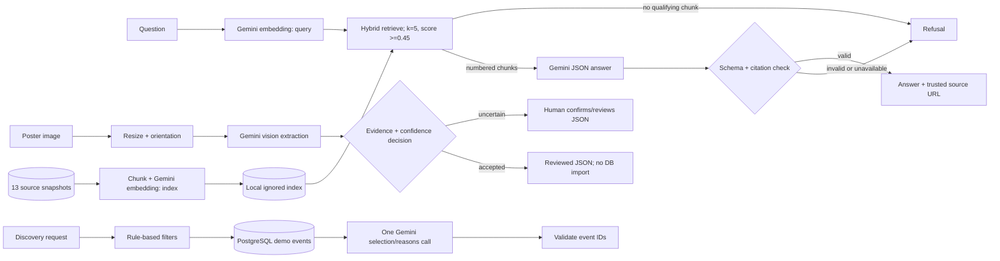

# Design Review · goLocal-AI · Signal Stack

**Team:** [Archil Sanikidze](../TEAM-CONTRACT.md) (`Archi-lee-Sun`, spec keeper); Ana Kahidze (`anakakhidze`, repo keeper); Nino Tsutskiridze (`ninotsutskiridze30-svg`, eval keeper). **Team repository:** [goLocal-AI](https://github.com/anakakhidze/goLocal-AI). **Review date:** 20 October 2026. **Submission tag:** `design-review`, to be created on `main` after team review.

**Evidence boundary.** This repository contains the [product spec](spec.md), [team contract](../TEAM-CONTRACT.md), individual HW1 work, and the team workflow. The working discovery, poster, and RAG slices cited below are in the separate [GoLocal repository at commit `a347f2d`](https://github.com/ninotsutskiridze30-svg/GoLocal/tree/a347f2d). They are demonstrated implementations, **not yet integrated into this repository's `main`**. There is no shared HTTP application or production deployment. This review reports that boundary instead of treating a companion-repository result as a team-repository release.

## 1 · Problem, users, success criteria

People in Georgia looking for an event must compare separate listings and may encounter incomplete, stale, or conflicting details. Our initial user is a Georgian-speaking person who can describe a city, date, budget, or type of experience in ordinary language. The intended product returns a small number of relevant options and explains their source; [the team spec](spec.md) defines the first, narrower slice against synthetic fixtures.

| Criterion | Check and current evidence |
|---|---|
| Source-grounded answers cite a retrieved document or refuse; golden pass rate at least 0.70. | [GoLocal golden set](https://github.com/ninotsutskiridze30-svg/GoLocal/blob/a347f2d/evals/golden.yaml) and [live result](https://github.com/ninotsutskiridze30-svg/GoLocal/blob/a347f2d/evals/results/2026-10-20-145601-live-k5.json): 8/10 source-based passes after audit (§4). This is companion-repository evidence. |
| A fabricated citation, uncited sentence, or weak retrieval score cannot produce an answer. | [Citation/refusal implementation](https://github.com/ninotsutskiridze30-svg/GoLocal/blob/a347f2d/src/golocal_data/rag_answer.py) and [offline tests](https://github.com/ninotsutskiridze30-svg/GoLocal/blob/a347f2d/tests/test_rag_answer.py); 186 repository tests passed locally in GoLocal. |
| Uncertain poster facts never enter an accepted draft without evidence. | [Confidence policy](https://github.com/ninotsutskiridze30-svg/GoLocal/blob/a347f2d/docs/confidence-policy.md) and [decision tests](https://github.com/ninotsutskiridze30-svg/GoLocal/blob/a347f2d/tests/test_poster_checks.py). A live vision evaluation is still pending. |
| The first discovery slice returns at most three validated fixture-backed events, with no more than one model call for a valid request. | [GoLocal discovery code](https://github.com/ninotsutskiridze30-svg/GoLocal/blob/a347f2d/src/golocal_data/discovery.py) and its tests; the team's planned HTTP 400 criterion remains unimplemented. |

## 2 · Architecture and data flow

These are **GoLocal CLI/service paths**, not endpoints in goLocal-AI. The RAG index is an ignored local file; the 13 Markdown snapshots and their URLs are [versioned in GoLocal](https://github.com/ninotsutskiridze30-svg/GoLocal/tree/a347f2d/data/corpus/events). Query and chunk embeddings use `gemini-embedding-2`; answer generation, poster extraction, and batched discovery selection use `gemini-3.1-flash-lite` through the [shared provider](https://github.com/ninotsutskiridze30-svg/GoLocal/blob/a347f2d/src/golocal_data/llm.py). The RAG model receives retrieved text, but application code attaches the trusted source URL and rejects invalid markers. A poster's low-confidence fields are cleared for human review; there is no review UI or automatic event insertion. PostgreSQL currently serves fictional demo rows for discovery, not the RAG documents or reviewed posters. [Retrieval contract](https://github.com/ninotsutskiridze30-svg/GoLocal/blob/a347f2d/docs/retrieval-spec.md) · [poster contract](https://github.com/ninotsutskiridze30-svg/GoLocal/blob/a347f2d/docs/multimodal-spec.md).

## 3 · Risks and safety threats

| Risk and user impact | Existing mitigation or dated next step | Owner |
|---|---|---|
| A plausible but wrong event fact appears beside a real citation. | Source IDs and sentence markers are checked in [RAG code](https://github.com/ninotsutskiridze30-svg/GoLocal/blob/a347f2d/src/golocal_data/rag_answer.py); this proves provenance, not every claim. Add claim-level human review cases by Week 11. | Nino |
| A snapshot price, schedule, or seat count has changed. | [Corpus policy](https://github.com/ninotsutskiridze30-svg/GoLocal/blob/a347f2d/docs/retrieval-spec.md) forbids claims of current availability; unsupported questions refuse. Recheck source freshness before any production use. | Archil |
| A blurred poster yields an invented year or treats doors-open as start time. | [Deterministic decision policy](https://github.com/ninotsutskiridze30-svg/GoLocal/blob/a347f2d/docs/confidence-policy.md) clears unsupported fields and routes uncertainty to a person. Live extraction quality remains unverified. | Nino |
| Source text contains instructions intended to redirect the model. | The prompt labels retrieved text as data; ID and citation checks limit output. Add adversarial corpus tests by Week 11. | Archil |
| Gemini fails or retries raise latency and cost. | Bounded retries and explicit refusal are implemented; the [live result](https://github.com/ninotsutskiridze30-svg/GoLocal/blob/a347f2d/evals/results/2026-10-20-145601-live-k5.json) still contains HTTP 503. Measure complete request cost before setting a service target. | Ana |
| Public performer names in the companion corpus conflict with Lab 4's shareable-corpus guidance. | No personal user data or key belongs in this review. Resolve the corpus policy with the team/instructor before a graded merge; do not silently relabel the existing documents. | Ana |

## 4 · Evaluation plan

The [GoLocal golden set](https://github.com/ninotsutskiridze30-svg/GoLocal/blob/a347f2d/evals/golden.yaml) has ten fixed questions: four factual, two two-document reasoning, two edge, and two refusal. With `k=5` and threshold `0.45`, the [third committed live report](https://github.com/ninotsutskiridze30-svg/GoLocal/blob/a347f2d/evals/results/2026-10-20-145601-live-k5.json) records **9/10 (0.90)** under the original scorer. One apparent refusal pass (g5) was caused by model timeout, not source reasoning; the source-based audit is **8/10 (0.80)**. g10 failed because Gemini returned HTTP 503. The [scorer now rejects provider failures as successful refusals](https://github.com/ninotsutskiridze30-svg/GoLocal/blob/a347f2d/evals/run_golden.py); there has been no fourth live run under that corrected scorer. The source-based audit still exceeds the 0.70 gate. Offline tests use fake providers and do not prove live model quality.

By Week 11, add a format question without weakening the existing ten, run the corrected golden scorer in a controlled evaluation gate, and block a merge below 0.70. Review factual claims as well as citation shape. The current golden set and results must first be brought into this team repository through review; they are not present on its `main` today.

## 5 · Token budget and retrieval choice

The following measurements came from **local, ignored** `GoLocal/logs/rag_usage.jsonl` on 20 October; the raw log is not a committed team-repository artifact. Counts include three live golden runs and local checks. Costs are the provider adapter's estimates, not invoices.

| Call | Observed calls | Median successful usage | Median successful latency | Recorded cost |
|---|---:|---|---:|---:|
| Gemini grounded generation | 39 attempts; 17 successful | 1,362 input / 63 output tokens | 7.613 s | $0.0004687 per successful call (median) |
| Gemini query/index embedding | 57 successful | 51 input tokens | 1.036 s | Not calculated in the log |

At the [spec's planning load](spec.md) of 20 requests/day for 30 days, 600 × $0.0004687 = **$0.28122/month for successful generation only**. Query embeddings, failed calls, retries, index rebuilding, and hosting are excluded; therefore this is **not** a measured end-to-end cost or proof of the spec's $2 target. End-to-end latency is also not recorded. The [adapter's recorded text rates](https://github.com/ninotsutskiridze30-svg/GoLocal/blob/a347f2d/src/golocal_data/llm.py) are $0.25/M input and $1.50/M output tokens. As an illustrative comparison, the 26 indexed chunks consumed 5,944 embedding input tokens in the local build, versus 1,362 median generation input tokens with retrieval. Holding output at 63 tokens gives about **$0.00158** to send all chunk text versus **$0.00044** for the smaller retrieved prompt, before query-embedding and retry costs. These are token-count proxies across different calls, not a production benchmark; retrieval is also chosen because it gives a small, checkable citation set. Commit a sanitized usage summary and measure full requests before setting a budget gate.

## 6 · Team, roles and decisions

The signed [team contract](../TEAM-CONTRACT.md) and [repo guide, §1](TEAM-REPO.md) assign Ana to repository controls, Archil to the living spec, and Nino to evaluation. Decisions require all three members' agreement. The companion repository has [one recorded RAG index/retry decision](https://github.com/ninotsutskiridze30-svg/GoLocal/blob/a347f2d/docs/decisions/0001-rag-local-index.md); this team repository currently has only a [decision template](decisions/0000-template.md). A second approved decision record, the evidence and usage summary, and the companion slices on this repository's `main` are **still required** for the rubric's full evidence trail. Ana coordinates the repository integration; Archil reconciles [this spec](spec.md) with the implemented paths; Nino reviews the golden run. This document was drafted with AI assistance; team review and an entry in [the delegation log](delegation-log.md) are pending.
